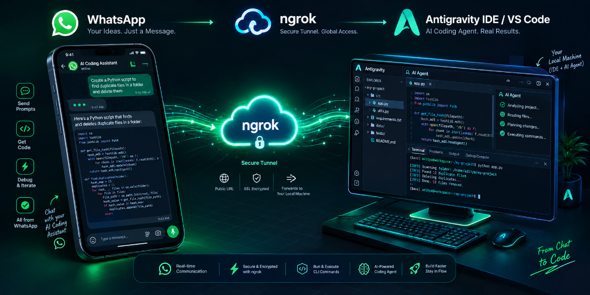

<p align="center">
  
</p>

# 🌌 Pocket Antigravity
> **Your Ideas. Just a Message.**  
> Seamlessly control, prompt, and collaborate with your local **Google Antigravity AI Coding Agent** directly from **WhatsApp** — anywhere, anytime.

<p align="center">
  <a href="https://nodejs.org"></a>
  <a href="https://developers.facebook.com/products/whatsapp/"></a>
  <a href="https://ngrok.com"></a>
  <a href="https://github.com/ADITYA-user18/pocket-antigravity/blob/main/LICENSE"></a>
</p>

---

## 🚀 Overview

**Pocket Antigravity** creates an ultra-fast, bidirectional bridge between **WhatsApp** and your local **Antigravity AI IDE (`agy` CLI)**. Whether you're commuting, away from your desk, or brainstorming on your phone:

- 💬 Send coding prompts or debugging queries as simple WhatsApp messages.
- ⚡ **Real-Time 3-Dot Typing Feedback**: Animated typing indicator appears in-stream below your message until the AI finishes generating code.
- 📂 **Auto-Detect Active Workspace**: Automatically tracks whichever project folder is open in your Antigravity IDE.
- 🔀 **Remote Workspace Switcher**: Switch projects on the fly with `/projects` and `/project <name>`.
- 🖼️ **Image & Screenshot Support**: Send UI screenshots or bug pictures from your phone directly into the agent context.
- 📱 **Mobile-Optimized Output**: Converts Markdown tables, code blocks, and trees into clean, formatted mobile chat.
- 🔒 **End-to-End Security**: Whitelists your personal phone number and uses SSL-encrypted tunnels.

---

## 🏗️ Architecture & Data Flow

```
   ┌─────────────────┐
   │ 📱 Your Phone   │
   │    (WhatsApp)   │
   └────────┬────────┘
            │ 1. Send Prompt / Image / Command
            ▼
   ┌────────────────────────┐
   │ ☁️ Meta Cloud API      │
   │  (WhatsApp Webhook)    │
   └────────┬───────────────┘
            │ 2. HTTPS Webhook Payload
            ▼
   ┌────────────────────────┐
   │ 🌐 ngrok Secure Tunnel │ (Encrypted Public URL)
   └────────┬───────────────┘
            │ 3. Forward to localhost:3000
            ▼
   ┌─────────────────────────────────────────────────────────────┐
   │ 🤖 Pocket Antigravity Bridge (Node.js Express Server)       │
   │  • Phone Number Verification & Security Filter              │
   │  • Immediate WhatsApp Typing Dots (heartbeat loop)          │
   │  • Active IDE Workspace Auto-Detector                       │
   │  • Mobile WhatsApp Text Formatter                           │
   └────────┬────────────────────────────────────────────────────┘
            │ 4. Spawn agy CLI with target directory & prompt
            ▼
   ┌─────────────────────────────────────────────────────────────┐
   │ ⚡ Google Antigravity Agent (agy CLI) & Local IDE Workspace │
   │  • Autonomous file reading, planning, & code execution       │
   │  • Instant response returned to WhatsApp                     │
   └─────────────────────────────────────────────────────────────┘
```

---

## 🛠️ Prerequisites & Essential Links

Before setting up, make sure you have accounts and access to the following free developer services:

| Resource | Purpose | Official Link |
| :--- | :--- | :--- |
| **Node.js 18+** | JavaScript runtime to run the bridge server | [nodejs.org](https://nodejs.org/) |
| **Antigravity IDE & `agy` CLI** | Autonomous AI Coding Assistant | [Antigravity IDE](https://antigravity.google/) |
| **Meta for Developers** | WhatsApp Business Cloud API & Webhooks | [developers.facebook.com](https://developers.facebook.com/) |
| **ngrok** | Encrypted public HTTPS tunnel for local webhooks | [dashboard.ngrok.com](https://dashboard.ngrok.com/) |

---

## 📦 Step-by-Step Installation

### 1. Clone the Repository
```bash
git clone https://github.com/ADITYA-user18/pocket-antigravity.git
cd pocket-antigravity
```

### 2. Install Dependencies
```bash
npm install
```

---

### 3. Obtain Developer Credentials

#### A. Meta WhatsApp Cloud API Setup:
1. Open [Meta for Developers](https://developers.facebook.com/apps/) and create an App (Type: **Business**).
2. Add the **WhatsApp** product to your app.
3. In **API Setup** (`WhatsApp` → `API Setup`):
   - Copy your **Phone Number ID**.
   - Copy your **Temporary Access Token** (or generate a [Permanent System User Token](#-creating-a-permanent-meta-token-recommended)).
   - Add your recipient phone number under **To** for testing.

#### B. ngrok Setup:
1. Sign up for a free account on [ngrok.com](https://ngrok.com/).
2. Copy your **Authtoken** from [ngrok Dashboard: Your Authtoken](https://dashboard.ngrok.com/get-started/your-authtoken).
3. *(Optional but Recommended)* Claim a free permanent static domain from [ngrok Domains](https://dashboard.ngrok.com/domains) (e.g., `your-name.ngrok-free.app`).

---

### 4. Configure Environment Variables

Copy `.env.example` to `.env`:
```bash
cp .env.example .env
```

Edit `.env` with your credentials:
```env
# WhatsApp Business Cloud API (from Meta Developer Console)
WHATSAPP_PHONE_NUMBER_ID=1370944636099692
WHATSAPP_ACCESS_TOKEN=your_whatsapp_access_token_here

# Your Personal WhatsApp Number (with country code, no + or dashes)
# e.g., 919876543210 for India (+91), 14155552671 for US (+1)
MY_WHATSAPP_NUMBER=917975094214

# Webhook Verify Token (any custom secret string you choose)
WEBHOOK_VERIFY_TOKEN=my_antigravity_bridge_token

# Target workspace mode ('auto' dynamically tracks open IDE window)
PROJECT_DIR=auto

# Agent model and reasoning effort
AGY_MODEL=
AGY_EFFORT=high
AGY_PRINT_TIMEOUT=10m0s

# ngrok Configuration
NGROK_AUTHTOKEN=your_ngrok_authtoken_here
NGROK_DOMAIN=your-static-domain.ngrok-free.app # Optional: Leave empty for random URL
```

---

### 5. Launch the Server

Run:
```bash
npm start
```
*Output will display:*
```text
============================================================
  🤖 WhatsApp ↔ Antigravity Bridge Server
============================================================
  📡 Server running on http://localhost:3000
  📂 Active Project: my-project (D:\projects\my-project)
  🔍 Detection Mode: active IDE window
  💚 Health check: http://localhost:3000/health
============================================================
  🌐 PUBLIC URL: https://your-domain.ngrok-free.app
  🔗 WEBHOOK URL: https://your-domain.ngrok-free.app/webhook
============================================================
  📲 Ready! Send a WhatsApp message to test.
```

---

### 6. Configure Meta Webhook URL

1. Go to [Meta Developer Console](https://developers.facebook.com/apps/) → Your App → **WhatsApp** → **Configuration**.
2. Click **Edit** under **Webhook**:
   - **Callback URL**: `https://your-domain.ngrok-free.app/webhook` (shown in your terminal)
   - **Verify Token**: The same value you set in `WEBHOOK_VERIFY_TOKEN` (e.g., `my_antigravity_bridge_token`)
3. Click **Verify and Save**.
4. Under **Webhook fields**, click **Manage** and subscribe to **`messages`**.

---

## 📱 Interactive WhatsApp Commands

You can control your agent and local IDE directly from WhatsApp chat using simple slash commands:

| Command | Action | Example |
| :--- | :--- | :--- |
| `/workspace` or `/status` | Shows the currently active workspace directory and detection mode | `/status` |
| `/projects` | Lists all recently opened workspace folders from Antigravity IDE | `/projects` |
| `/project <number>` | Switches target directory to one of the numbered projects from `/projects` | `/project 2` |
| `/project <path>` | Locks agent to a specific directory path on your PC | `/project d:\my-app` |
| `/project auto` | Restores auto-tracking of whichever folder is focused in Antigravity IDE | `/project auto` |
| `/help` | Shows the command cheatsheet | `/help` |

> 💬 **Regular Chat**: Any text message not starting with `/` is executed by `agy` inside the active project directory!

---

## 🔑 Creating a Permanent Meta Token (Recommended)

To prevent your token from expiring every 24 hours:
1. Go to **Meta Business Suite** → **Business Settings** → **System Users**.
2. Click **Add** (Role: **Admin**).
3. Click **Add Assets** → Select your WhatsApp App → Toggle **Full Control**.
4. Click **Generate New Token**:
   - App: Select your app.
   - Expiration: **Never**.
   - Permissions: Select `whatsapp_business_messaging` and `whatsapp_business_management`.
5. Copy the generated token and paste it as `WHATSAPP_ACCESS_TOKEN` in `.env`.

---

## 🖥️ Running as a Windows Background Task

To keep the bridge running seamlessly in the background on startup:

```powershell
# Run the included background task installer
.\install-task.ps1
```

Or run directly in background using PowerShell:
```powershell
.\start.ps1
```

---

## 🛡️ Security & Privacy

- **`.gitignore` Enforced**: API tokens, `.env` files, logs, and received images are strictly excluded from version control.
- **Phone Whitelist**: Only incoming webhooks matching `MY_WHATSAPP_NUMBER` are processed. Unauthorized senders are automatically rejected.
- **Local Execution**: All code modifications and agent actions execute strictly on your own machine.

---

## 📄 License

This project is licensed under the [MIT License](LICENSE).

---

<p align="center">
  <b>Built with ❤️ for developers who build at the speed of thought.</b><br>
  <sub>Contributions, issues, and feature requests are welcome!</sub>
</p>
